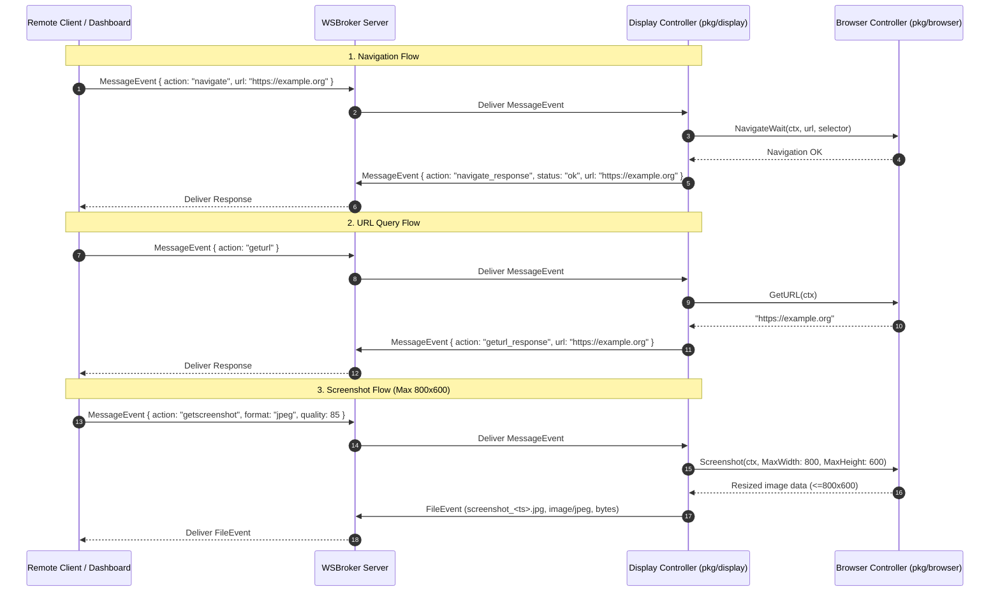

# WSBroker Display

A high-performance, real-time display and monitoring service with automated Chromium browser control for the **WSBroker** ecosystem, built in Go with `wsbrokerclient`, `certloader/v2`, and Chrome DevTools Protocol (`chromedp`).

---

## Features

- **Automated Chromium Browser Engine (`pkg/browser`)**:
  - Context-aware lifecycle management (`Start`, `Navigate`, `Evaluate`, `Screenshot`, `Click`, `Close`).
  - Active URL query (`GetURL`).
  - Viewport & full-page screenshot capturing with aspect-ratio bounding (max 800x600), on-the-fly resizing, Gaussian sharpening, and JPEG/PNG encoding.
  - Generic type-safe JavaScript evaluation (`EvaluateGeneric[T]`, `EvaluateFunction[T]`).
  - Native DOM & coordinate-based mouse interactions with visibility polling.
  - Real-time console logging interception (`EventConsoleAPICalled`).
- **WebSocket Remote Browser Control (`pkg/display` & `pkg/client`)**:
  - Real-time remote browser management over encrypted WSBroker connections.
  - Navigation command (`navigate`) with optional DOM selector readiness synchronization.
  - Active URL inspection command (`geturl`).
  - Bandwidth-efficient bounded screenshot command (`getscreenshot`, max 800x600 resolution) delivered via binary file events (`event.TypeFile`).
  - Deterministic correlation tokens and request-reply routing.
- **REST Service (`pkg/rest`)**:
  - Localhost-restricted HTTP API endpoints.
  - OpenAPI 3.1 specification & interactive Swagger UI documentation (`/swagger/index.html`).
  - Health check & ping endpoint (`/api/v1/ping`).
- **WSBroker Integration & Security**:
  - mTLS authentication and automatic token/certificate management via `certloader/v2` (MiniVault, Local Files, Dev, ACME).
  - Multi-channel pub/sub and direct messaging support.
  - Coordinated graceful shutdown handling (`SIGINT` / `SIGTERM`) with resource cleanup.

---

## Architecture

```mermaid
graph TD
    subgraph Remote["Remote Controller / Admin"]
        Sender["Remote App / Dashboard using pkg/client"]
    end

    subgraph BrokerSystem["WSBroker Infrastructure"]
        Broker["WSBroker Server"]
    end

    subgraph DisplayService["wsbrokerdisplay Service"]
        RawBrokerClient["wsbrokerclient (Raw WebSocket Client)"]
        DisplayCoord["pkg/display (Display Coordinator)"]
        BrowserEngine["pkg/browser (Chromium CDP Engine)"]
        ChromeProcess["Chromium Process"]
        RESTCtrl["pkg/rest (Local REST API)"]
    end

    Sender -->|1. Navigate / GetURL / Screenshot Command| Broker
    Broker -->|2. Deliver WebSocket Message Event| RawBrokerClient
    RawBrokerClient -->|3. Route Event| DisplayCoord
    DisplayCoord -->|4. Execute CDP Operation| BrowserEngine
    BrowserEngine -->|5. CDP Commands| ChromeProcess
    ChromeProcess -->|6. DOM State / Viewport Image| BrowserEngine
    BrowserEngine -->|7. URL / Resized Image (<=800x600)| DisplayCoord
    DisplayCoord -->|8. Send Response / File Event| RawBrokerClient
    RawBrokerClient -->|9. WebSocket Event| Broker
    Broker -->|10. Deliver Response / Preview| Sender
```

---

## WebSocket Remote Control Protocol

The display service accepts JSON commands inside standard WSBroker `event.TypeMessage` events and responds back to the sender client (or channel).

### 1. Navigate (`navigate`)

Instructs the display browser to load a target URL. An optional CSS `selector` can be provided to wait until a specific element is present in the DOM before confirming completion.

#### Request Payload
```json
{
  "action": "navigate",
  "url": "https://example.org",
  "selector": "#main-content"
}
```

#### Success Response (`navigate_response`)
```json
{
  "action": "navigate_response",
  "status": "ok",
  "url": "https://example.org"
}
```

#### Error Response (`navigate_response`)
```json
{
  "action": "navigate_response",
  "status": "error",
  "url": "https://example.org",
  "error": "failed to navigate to URL 'https://example.org': context deadline exceeded"
}
```

---

### 2. Get Current URL (`geturl`)

Queries the browser for the current primary location URL (`window.location.href`).

#### Request Payload
```json
{
  "action": "geturl"
}
```

#### Response Payload (`geturl_response`)
```json
{
  "action": "geturl_response",
  "url": "https://example.org/dashboard"
}
```

---

### 3. Get Screenshot (`getscreenshot`)

Captures the current browser viewport and downscales it to fit within a **maximum resolution of 800x600 pixels** (preserving aspect ratio) using Lanczos interpolation.

#### Request Payload
```json
{
  "action": "getscreenshot",
  "format": "jpeg",
  "quality": 85
}
```
*Parameters*:
- `format` *(string, optional)*: `"jpeg"` (default) or `"png"`.
- `quality` *(int, optional)*: Compression quality for JPEG (1–100, default `85`).

#### Success Response
Sent as a binary file event (`event.TypeFile`) to the requester:
- **Filename**: `screenshot_<unix_timestamp>.jpg` (or `.png`)
- **MIME Type**: `image/jpeg` or `image/png`
- **Data**: Binary image payload fitted within max 800x600 pixels.

#### Error Response (`getscreenshot_response`)
```json
{
  "action": "getscreenshot_response",
  "status": "error",
  "error": "failed to capture viewport screenshot: context deadline exceeded"
}
```

---

## Remote Control Sequence Flow



---

## Project Structure

```
wsbrokerdisplay/
├── cmd/
│   └── wsbrokerdisplay/
│       ├── config.go            # Application configuration & loader
│       ├── config_test.go       # Configuration loader unit tests
│       └── main.go              # Application lifecycle, startup & graceful shutdown
├── pkg/
│   ├── browser/
│   │   ├── browser.go           # Core Chromium CDP controller & lifecycle
│   │   ├── browser_test.go      # Browser lifecycle, navigation & screenshot tests
│   │   ├── click.go             # DOM selector & coordinate mouse interactions
│   │   ├── config.go            # Browser engine configuration
│   │   ├── console.go           # Console event listener & handler
│   │   ├── evaluate.go          # Type-safe generic JavaScript evaluation
│   │   ├── navigate.go          # Page navigation, DOM readiness & URL inspection
│   │   ├── README.md            # Browser package documentation
│   │   └── screenshot.go        # Viewport/full-page capture & max dimension bounding
│   ├── client/
│   │   ├── client.go            # High-level remote browser control client SDK
│   │   ├── client_test.go       # Remote control API & serialization unit tests
│   │   ├── models.go            # Command & response message payload models
│   │   └── README.md            # Client SDK package documentation
│   ├── display/
│   │   ├── controller.go        # Display coordinator & WebSocket command router
│   │   ├── controller_test.go   # Command dispatching & response routing unit tests
│   │   ├── models.go            # Display coordinator command & response models
│   │   └── README.md            # Display coordinator package documentation
│   └── rest/
│       ├── api.go               # Gin REST controller & routing
│       ├── api_test.go          # REST endpoints & integration tests
│       ├── handlers.go          # REST handler implementations
│       ├── resultMessage.go     # Standardized JSON response models
│       ├── swagger.md           # Swagger generation notes
│       └── docs/                # Generated OpenAPI 3.1 Swagger documentation
├── certs/                       # Certificates directory for mTLS
├── config/
│   ├── display.toml             # Default application configuration
│   └── embed.go                 # Embedded configuration loader
├── go.mod
└── go.work
```

---

## Configuration (`display.toml`)

```toml
addr = "localhost:8760"
extaddr = "http://localhost:8760"
name = "display01"
wsbroker = "https://localhost:8765"
channels = ["all", "intern", "display"]

[browser]
headless = true
kiosk = false
window_width = 1920
window_height = 1080
ignore_cert_errors = true
timeout = "30s"

[clienttls]
type = "minivault"

[clienttls.minivault]
baseurl = "https://localhost:8759/api/v1"
parenttoken = "xxxxxx"
tokentype = "client_cert"
tokenpolicies = ["wsbroker.client"]
certtype = "client_cert"
uris = ["wsbroker:client:display01", "wsbroker:channel:all", "wsbroker:channel:intern", "wsbroker:channel:display"]
ca = ["certs/minivault.ca.pem"]
usesystempool = false

[webtls]
type = "dev"
```

---

## Build & Run

### Compilation
```bash
go build -o wsbrokerdisplay.exe ./cmd/wsbrokerdisplay
```

### Running with embedded default configuration
```bash
./wsbrokerdisplay.exe
```

### Running with a custom configuration file
```bash
./wsbrokerdisplay.exe -config /path/to/display.toml
```

---

## Testing

Run all unit and integration tests across all packages:

```bash
go test -v ./...
```
