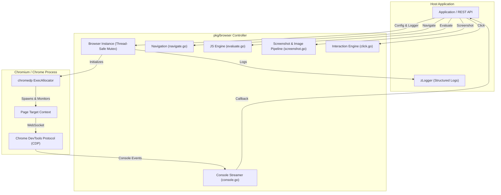
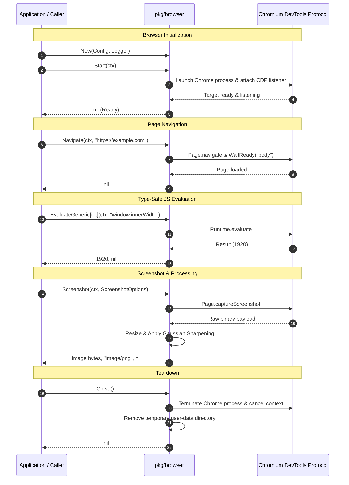

# Browser Package (`pkg/browser`)

The `pkg/browser` package provides an automated, high-level, and resilient controller for headless and kiosk Chromium/Chrome browser instances. Built on the Chrome DevTools Protocol ([`chromedp`](https://github.com/chromedp/chromedp)), it provides full lifecycle management, DOM navigation, type-safe JavaScript evaluation, mouse interaction, real-time console event streaming, and viewport/full-page screenshot capturing with image processing.

---

## Key Features

- **Lifecycle & Context Safety**:
  - Thread-safe initialization (`Start`), execution, and graceful teardown (`Close`).
  - Automatic isolation of user profile data (`UserDataDir` or temporary directories).
  - Explicit propagation of `context.Context` cancellation and deadlines to prevent leaked goroutines and hanging processes.
- **Navigation & DOM Synchronization**:
  - High-level navigation (`Navigate`) with configurable selector synchronization (`NavigateWait`).
- **Type-Safe JavaScript Evaluation**:
  - Generic evaluation helpers (`EvaluateGeneric[T]`, `EvaluateFunction[T]`) with automatic JSON deserialization into Go structs and primitive types.
- **Viewport & Full-Page Screenshots**:
  - Capture viewport or full scrollable page in PNG or JPEG format.
  - On-the-fly Lanczos downscaling and Gaussian sharpening via `imaging`.
- **Intelligent Mouse Interaction**:
  - Click by CSS selector with visibility polling (`WaitVisible`).
  - Native coordinate-based clicks with configurable mouse buttons (`left`, `middle`, `right`) and click counts.
- **Real-Time Console Interception**:
  - Non-blocking handler registration (`SetConsoleHandler`) capturing browser `console.log`, `console.warn`, `console.error`, and `console.info` events.

---

## Architecture & Lifecycle



---

## Detailed Operation Flow



---

## File Structure

The `pkg/browser` package is modularized by functional domain:

| File | Primary Responsibility |
| :--- | :--- |
| `config.go` | Browser configuration (`Config`) and defaults (`DefaultConfig`). |
| `browser.go` | Core `Browser` struct, lifecycle (`Start`, `Close`, `IsRunning`), and CDP allocator context. |
| `navigate.go` | Navigation helpers (`Navigate`, `NavigateWait`). |
| `screenshot.go` | Viewport/full-page capture and image scaling/sharpening pipeline. |
| `click.go` | DOM selector and coordinate-based mouse click dispatchers. |
| `evaluate.go` | Type-safe generic JavaScript evaluation (`EvaluateGeneric`, `EvaluateFunction`). |
| `console.go` | Asynchronous browser console log stream interception. |
| `browser_test.go` | Unit and integration tests covering the complete browser lifecycle. |

---

## Configuration

```go
type Config struct {
    Headless         bool          // Run Chrome without GUI window (default: true)
    Kiosk            bool          // Run Chrome in full-screen kiosk mode (default: false)
    WindowWidth      int           // Viewport and window width (default: 1920)
    WindowHeight     int           // Viewport and window height (default: 1080)
    UserDataDir      string        // Custom profile dir; empty = temporary directory auto-cleaned on Close
    IgnoreCertErrors bool          // Bypass TLS/SSL certificate validation errors (default: true)
    Timeout          time.Duration // Default timeout per operation (default: 30s)
    ExecPath         string        // Optional custom binary path for Chrome / Chromium
    CustomFlags      []string      // Additional command-line flags passed to Chrome
}
```

---

## Usage Examples

### 1. Initialization and Lifecycle

```go
package main

import (
    "context"
    "time"

    "github.com/je4/utils/v2/pkg/zLogger"
    "github.com/je4/wsbrokerdisplay/pkg/browser"
    "github.com/rs/zerolog"
)

func main() {
    var logger zLogger.ZLogger = &zerolog.Nop()

    conf := browser.DefaultConfig()
    conf.Headless = true
    conf.WindowWidth = 1920
    conf.WindowHeight = 1080

    b := browser.New(conf, logger)

    // Capture console output
    b.SetConsoleHandler(func(msg browser.ConsoleMessage) {
        println("[Browser Console]", msg.Level, msg.Message)
    })

    ctx, cancel := context.WithTimeout(context.Background(), 10*time.Second)
    defer cancel()

    if err := b.Start(ctx); err != nil {
        panic(err)
    }
    defer b.Close()
}
```

### 2. Navigation & JavaScript Evaluation

```go
ctx := context.Background()

// Navigate to target URL
if err := b.Navigate(ctx, "https://example.org"); err != nil {
    panic(err)
}

// Evaluate primitive values
title, err := browser.EvaluateGeneric[string](ctx, b, "document.title")
if err != nil {
    panic(err)
}
println("Title:", title)

// Evaluate complex JSON objects into structs
type PageInfo struct {
    URL        string   `json:"url"`
    Paragraphs int      `json:"paragraphs"`
}

info, err := browser.EvaluateGeneric[PageInfo](ctx, b, `({
    url: window.location.href,
    paragraphs: document.querySelectorAll('p').length
})`)
if err != nil {
    panic(err)
}
println("Page URL:", info.URL, "Paragraph count:", info.Paragraphs)
```

### 3. Capturing & Resizing Screenshots

```go
ctx := context.Background()

opts := browser.ScreenshotOptions{
    Format:       "jpeg",
    Quality:      85,
    FullPage:     false,
    Width:        800,  // Downscale to width 800px (aspect ratio preserved if Height is 0)
    SharpenSigma: 0.75, // Apply sharpening for high visual clarity
}

imageBytes, mimeType, err := b.Screenshot(ctx, opts)
if err != nil {
    panic(err)
}
println("Captured image size:", len(imageBytes), "bytes, MIME:", mimeType)
```

### 4. Mouse Clicks and Visibility Waiting

```go
ctx := context.Background()

// Click a button by selector with visibility synchronization
err := b.Click(ctx, browser.ClickOptions{
    Selector:    "#submit-btn",
    WaitVisible: true,
    Button:      "left",
})
if err != nil {
    panic(err)
}

// Coordinate-based click (e.g. for canvas or fixed layouts)
err = b.Click(ctx, browser.ClickOptions{
    X:      350.0,
    Y:      120.0,
    Button: "left",
})
if err != nil {
    panic(err)
}
```

---

## Concurrency & Thread-Safety

- `Browser` is fully thread-safe for concurrent read/status calls (`IsRunning`).
- Mutex locks and child context derivations ensure that concurrent or sequential actions (`Navigate`, `Screenshot`, `Click`, `Evaluate`) are serialized safely on the underlying CDP connection without interfering with allocator contexts.
- Temporary user-data directories are tracked and guaranteed to be deleted on `Close()` or when re-starting an active instance.
